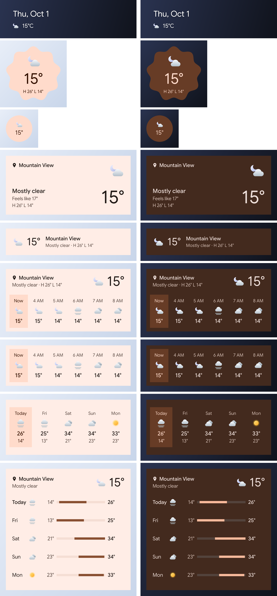

# PartKit — Pixel 스타일 위젯

Jetpack Glance로 만든 Google Pixel 스타일 홈 화면 위젯입니다. Android 12+(minSdk 31)를 지원합니다.

| 위젯 | 기본 크기 | 크기별 형태 |
|---|---|---|
| 한눈에 보기 (At a Glance) | 4×1 | 날짜 또는 1시간 이내 일정 + 날씨, 곧 올 비/눈 알림 |
| 날씨 · 현재 | 2×2 | 쿠키 도형(M3 Expressive), 1×1에서는 원 |
| 날씨 · 예보 | 4×2 | 도시·상태·체감·최고/최저, 낮게 줄이면 한 줄 |
| 날씨 · 시간별 | 4×2 | 6시간 예보, 높게 늘리면 헤더 추가 |
| 날씨 · 5일 | 4×2 | 요일 열, 높게 늘리면 기온 범위 막대 목록 |



날씨 위젯과 At a Glance의 날씨 줄을 누르면 **기기의 날씨 앱**이 열립니다(`WeatherApps`).
제조사 기본 날씨 앱(Samsung `com.sec.android.daemonapp`, Xiaomi, OPPO/OnePlus, vivo, Huawei 등)을 먼저 찾고,
없으면 `CATEGORY_APP_WEATHER`를 선언한 앱을 엽니다(여러 개면 선택 화면). 둘 다 없으면 PartKit을 엽니다.
어떤 앱이 잡혔는지는 앱 설정 화면의 "위젯을 누르면 여는 날씨 앱"에서 확인할 수 있습니다.

앱 설정의 **영어로 표시**를 켜면 시스템·앱별 언어와 관계없이 모든 위젯과 앱 화면이 영어로 나옵니다
(`AppLocale`). Android 12도 지원해야 해서 시스템의 앱별 언어(Android 13+) 대신 이 앱만의 설정으로 두고,
위젯 구성의 `LocalContext`와 액티비티의 기본 컨텍스트를 영어 구성으로 감싸 적용합니다. 지명도 해당 언어로 다시
받아 옵니다. 날짜는 컨텍스트 로캘을 쓰는 `java.time`으로 만듭니다. `DateFormat.format()`/`DateUtils`는 프로세스
기본 로캘을 써서 이 설정을 따르지 않기 때문입니다.

## 구조

- `data/`: Open-Meteo 클라이언트(API 키 없음), 캐시(`WeatherStore`, StateFlow), 위치·캘린더
- `sync/`: WorkManager 30분 주기 새로고침, 모든 위젯 갱신
- `glance/common/`: 디자인 토큰(시스템 위젯 모서리 반경, 동적 색상)과 번들 폰트 텍스트 컴포넌트(`PixelText`)
- `glance/weather/`: 날씨 위젯 4종 (`SizeMode.Responsive`)
- `glance/ataglance/`: At a Glance. `TextClock`과 글자 그림자를 쓰려고 `AndroidRemoteViews`로 구성
- `tools/gen_drawables.py`: 쿠키 도형과 날씨 아이콘 벡터 생성기
- `tools/gen_fonts.py`: Google Sans와 Noto Sans KR을 합쳐 위젯용 폰트를 만드는 스크립트

## 글꼴: PartKit Sans (Google Sans + Noto Sans KR)

위젯과 앱 화면은 기기 글꼴 대신 앱에 넣은 폰트를 씁니다. 그래서 Pixel이 아닌 기기나 시스템 글꼴을 바꾼
기기에서도 한글까지 같은 모양으로 나옵니다.

- 라틴·숫자·기호: [Google Sans](https://github.com/google/fonts/tree/main/ofl/googlesans)
- 한글(현대 음절 11,172자 전체, 자모, CJK 문장부호, 전각 문자): [Noto Sans KR](https://github.com/google/fonts/tree/main/ofl/notosanskr).
  Pixel이 Google Sans와 함께 쓰는 한글 폰트 계열입니다.
- 두 폰트 모두 SIL OFL 1.1입니다. 합친 폰트는 수정본이라 이름을 `PartKit Sans`로 바꿨습니다.
  라이선스 전문은 `assets/licenses/`에 있습니다.
- 굵기별 파일은 `res/font/partkit_sans_{regular,medium}.ttf`이고 각 약 2.6MB입니다.
- 두 폰트를 한 파일로 합쳐서, 한 번에 하나의 Typeface로 라틴과 한글을 모두 그립니다.
- 한자·일본어 가나 등 이 폰트에 없는 문자는 시스템 폰트로 대체됩니다.
- 폰트를 다시 만들려면: `python -m pip install fonttools` 후 `python tools/gen_fonts.py`

### 위젯에서 앱 폰트를 쓰는 방법 (비트맵 텍스트)

런처는 위젯 레이아웃을 `Context.CONTEXT_RESTRICTED` 컨텍스트로 펼칩니다(`RemoteViews.java`). 이 컨텍스트에서
`TextView`는 `android:fontFamily`의 **앱 폰트 리소스를 읽지 않고** 시스템 폰트로 대체합니다
(`TextView#readTextAppearance`의 `!context.isRestricted()` 조건). `RemoteViews`로는 `Typeface` 객체도
넘길 수 없습니다. 그래서 위젯 텍스트는 다음처럼 그립니다.

- `WidgetText`가 앱 프로세스에서 번들 폰트로 텍스트를 비트맵에 그리고, 위젯은 이를 `ImageView`로 보여 줍니다.
- 날씨 위젯 텍스트는 알파 마스크(ALPHA_8)로 그리고 `GlanceTheme` 색으로 틴트합니다. 틴트 색은 런처가 그릴 때
  정해지므로 다크 모드와 배경화면 동적 색상이 그대로 따라갑니다.
- At a Glance는 배경화면 위 고정 색(흰 글자+그림자 / 어두운 글자)을 비트맵에 직접 굽습니다.
- 날짜는 더 이상 `TextClock`이 아니므로 `DateTick`이 자정(1분 창 알람)과 시각·시간대·언어 변경 때 다시 그립니다.
- 텍스트는 이미지라서 접근성용 `contentDescription`에 원문을 넣습니다.
- 문구가 비트맵에 구워지므로 언어가 바뀌면 다시 그려야 합니다. `LocaleSync`(`PartKitApp`)가 마지막으로 그린
  언어를 저장해 두고, 프로세스 시작·구성 변경 때 달라졌으면 모든 위젯을 다시 그립니다. 시스템 언어 변경과
  앱별 언어 변경(Android 13+) 모두 해당합니다.

## 디버그: 런처 없이 위젯 렌더링

```bash
tools/snapshot.sh
```

디버그 빌드를 설치하고, 화면을 띄우지 않는 `WidgetSnapshotReceiver`로 모든 위젯을 렌더링해
`build/snapshots/`로 가져옵니다. **런처와 같은 조건이 되도록 `CONTEXT_RESTRICTED` 컨텍스트로 적용**하므로,
런처에서 폰트·리소스가 어떻게 보일지 그대로 확인할 수 있습니다. Windows에서는
`GRADLEW_EXT=.bat tools/snapshot.sh`로 실행합니다.

소프트웨어 렌더링이라 모서리 둥글림(clipToOutline)은 스냅샷에 나타나지 않습니다.
